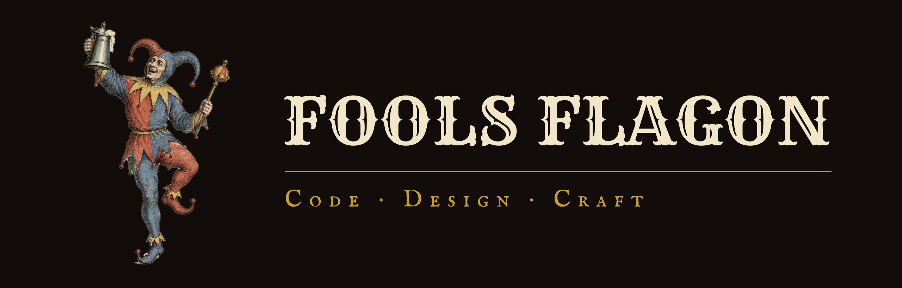

  

  <b>Fools Flagon</b> is an independent studio for software, design, and contract work. 
  Full-stack products built by an engineer with a graphic design background.

  
  
  
  

---

## ⚜ What we make

- **Web apps & SaaS** - full-stack products from schema to deploy
- **Data & analytics tools** - pipelines, models, and dashboards
- **Automation** - scripts and integrations that remove busywork
- **Brand & UI design** - logos, design systems, and interfaces

## ⚜ Projects

| Project | What it is | Status |
| --- | --- | --- |
| [**EdgeForge**]([LINK]) | Sports analytics platform for MLB, NBA, NHL & WNBA | Public beta |
| [**Sofron**]([LINK]) | Multi-tenant SaaS for cash-care clinics | Pre-launch |
| [**Victual**]([LINK]) | Recipe & meal planning app | In development |

## ⚜ Tools of the trade

**Languages** 

**Frontend** 
 

**Backend & data** 

**Cloud & DevOps** 

**Tools & testing** 

**Design** 
 

**Also in the toolbox** 

## ⚜ By the numbers

  
  

  

---

<i>Raise a flagon, ship the thing.</i>

